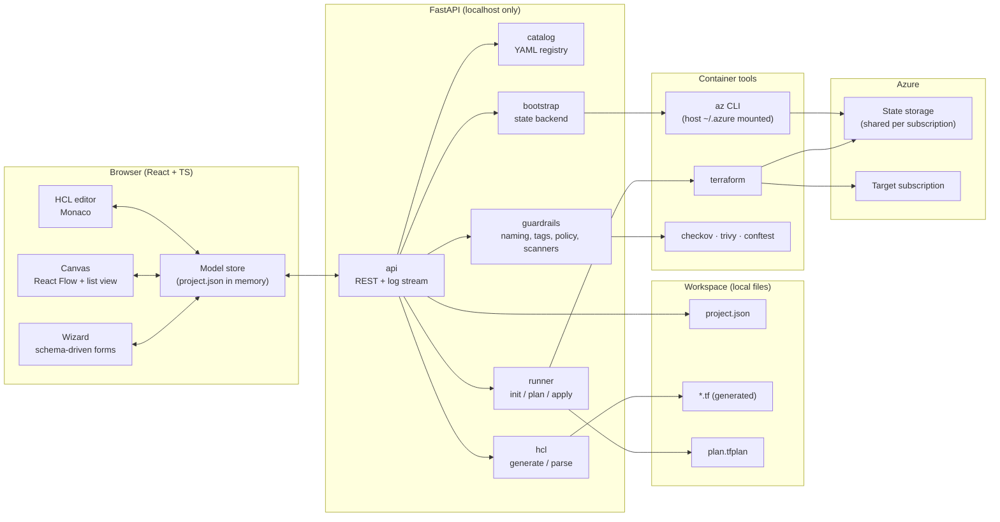
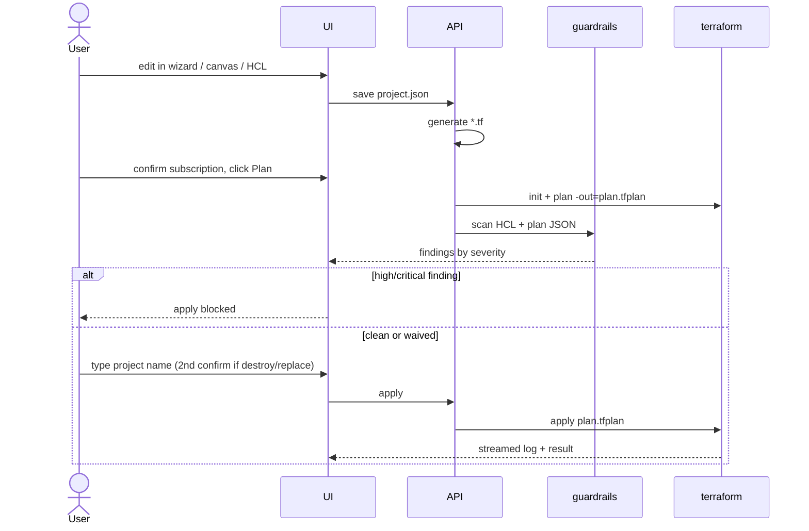

# LowDevOps architecture

LowDevOps is a single-user web app running on localhost inside a dev container. A React UI edits one internal model per project. A FastAPI backend turns that model into Terraform, checks it, and runs `plan` / `apply` as the signed-in Azure user. See [PRD.md](PRD.md) for the product decisions and [adr/](adr/) for why the main ones were made.

## Components



| Component    | Responsibility                                                                                                                                                                                                                                                                |
| ------------ | ----------------------------------------------------------------------------------------------------------------------------------------------------------------------------------------------------------------------------------------------------------------------------- |
| `catalog`    | Loads `catalog/*.yaml`. Serves input schemas (basic / advanced / hidden), CAF defaults and allowed references to the wizard and canvas                                                                                                                                        |
| `hcl`        | A deterministic generator (model → canonical HCL) and a parser (HCL → model + opaque custom-HCL blocks). Both are snapshot- and round-trip-tested                                                                                                                             |
| `guardrails` | CAF naming and tag rules and Conftest policies on the model; Checkov and Trivy on the plan JSON (AVM module calls are opaque before `terraform init`). Every finding gets a severity; `policies/scanners.yaml` picks the adopted scanner checks ([M4 spec](specs/M4/spec.md)) |
| `runner`     | Runs `terraform init/plan/show -json/apply` as subprocesses. Streams logs, keeps one run per project, and applies only the saved plan                                                                                                                                         |
| `bootstrap`  | Creates or checks the shared state backend through `az` and records it in local settings                                                                                                                                                                                      |

## Plan and apply flow



## Data model (`project.json`)

Pydantic models in `backend/app` are the source. The JSON Schema is generated from them and the frontend types are generated from the schema, so there is one definition.

```jsonc
{
  "schemaVersion": 1,
  "meta": {
    "name": "webapp-dev",
    "created": "...",
    "lowdevopsVersion": "0.1.0",
  },
  "subscription": { "id": "...", "tenantId": "...", "location": "westeurope" },
  "naming": {
    "workload": "webapp",
    "env": "dev",
    "region": "weu",
    "pattern": "{type}-{workload}-{env}-{region}",
  },
  "tags": { "env": "dev", "owner": "..." },
  "resources": [
    {
      "id": "vnet1", // stable; becomes module.vnet1
      "catalogRef": "avm-res-network-virtualnetwork@0.x.y",
      "parent": "rg1", // containment, drawn as nesting
      "inputs": { "address_space": ["10.0.0.0/16"] },
      "refs": [
        { "input": "resource_group_name", "to": "rg1", "output": "name" },
      ],
      "layout": { "x": 120, "y": 80 }, // canvas only; ignored by the generator
    },
  ],
  "customHcl": [{ "id": "c1", "hcl": "..." }], // verbatim, view-only in GUI
  "waivers": [
    {
      "findingId": "CKV_AZURE_35",
      "resource": "sa1",
      "reason": "...",
      "by": "...",
      "at": "...",
    },
  ],
}
```

## Sync rules

1. `project.json` is the only source of truth. Generated `.tf` files are derived and rebuilt from it.
2. Wizard and canvas edits update the model, and HCL regenerates right away.
3. HCL editor edits are parsed on save (or after a debounce). Blocks the parser can map become model resources. Anything else becomes a `customHcl` entry, kept byte for byte. If parsing fails, the model is left unchanged and the error shows inline.
4. The generator output is canonical, so saving reformats mapped blocks. Custom HCL is never reformatted.
5. Canvas edges are `refs`. The catalog decides which references are allowed, so the canvas cannot create a reference the catalog doesn't allow.

## Trust boundaries and safety

- The API binds to `127.0.0.1` only. There is no authentication because there is one user on one machine.
- The app never stores credentials. Terraform uses `ARM_USE_CLI=true` with the host's mounted `~/.azure`.
- Every subprocess call passes its arguments as a list (no shell). Project names and resource IDs are checked against a strict pattern before they reach a path or a command.
- Every subprocess goes through `backend/app/proc.py`: the binary is resolved to an absolute path, runs in its own process group (a timeout kills it and its workers), and gets an explicit environment. `az` and `terraform` never see service-principal variables (`AZURE_CLIENT_*`, `ARM_CLIENT_*`, `ARM_OIDC_*` and the like), so they act only as the signed-in user.
- Runs (bootstrap, plan, apply) are one at a time per key, with their log streamed as Server-Sent Events (`GET /api/runs/{id}/log`). Local settings (`<workspace>/settings.json`) record each subscription's state backend and hold no secrets.
- Apply runs only the reviewed `plan.tfplan`, needs typed confirmation, and needs a second confirmation for any destroy or replacement.
- State lives only in Azure Storage. `.gitignore` excludes `*.tfstate`, `*.tfplan` and `*.tfvars`.
